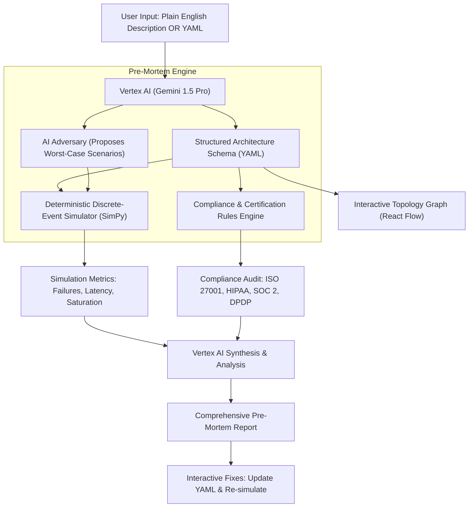

# Venessa: Pre-Mortem Architecture Simulator & Compliance Verifier
## Updated Product Vision & Goal Document (Google Buildathon 2026)

> **"Test before you deploy, simulate before you ship."**  
> A predictive pre-mortem simulator and compliance engine powered by **Google Vertex AI** that empowers startups to stress-test multi-cloud, multi-cluster architectures, uncover reliability flaws, and achieve regulatory readiness before touching production.

---

## 1. Executive Summary

Early-stage startups face immense pressure to ship quickly, yet deployment incidents and downtime immediately destroy customer trust and burn runway. Most engineering failures trace back to foundational architectural flaws—hidden bottlenecks, retry storms, cascading timeouts, single points of failure (SPOFs), or unaddressed compliance gaps—that are expensive and painful to fix after deployment.

**Venessa** is an AI-powered **design-time pre-mortem simulator**. Instead of waiting for real traffic or chaos tests to break production, Venessa allows teams to model, stress-test, and benchmark their system architectures *before* writing provisioning scripts or deploying infrastructure.

Using **Google Cloud Vertex AI (Gemini)**, Venessa translates natural-language system descriptions or YAML inputs into executable architecture graphs, pushes synthetic stress scenarios across multi-cloud and multi-cluster topologies, identifies failure modes, recommends concrete Google Cloud and multi-cloud solutions, and validates compliance against standards like **ISO 27001, HIPAA, SOC 2, and DPDP**.

---

## 2. The Strategic Pivot (Mentor Insights & Broadened Scope)

### Initial Hypothesis vs. New Direction

| Dimension | Initial Scope (Fintech Focus) | Updated Scope (New-to-Deployment Startups) |
|---|---|---|
| **Target Customer** | Indian Fintechs (UPI payment apps, neobanks) | Early-stage & scaling startups across sectors preparing for cloud deployment |
| **Primary Risk Addressed** | Double-debits & transaction financial loss | Pre-deployment blindspots, day-1 launch outages, customer churn, and architecture re-work |
| **Deployment Model** | Single region / payment gateway centric | **Multi-cloud and multi-cluster** (e.g., GCP + AWS, hybrid microservices, multi-region k8s) |
| **Analysis Focus** | Idempotency and payment retry storms | System resilience, cascading failures, capacity bottlenecks, AND **compliance readiness** |
| **Regulatory Scope** | Payment data localization / DPDP hints | Comprehensive compliance verification (**ISO 27001, HIPAA, SOC 2, DPDP, PCI-DSS**) |

### Why This Shift Matters
1. **The Post-Deployment Trap**: The vast majority of DevOps and SRE tools (APM, Datadog, New Relic, Chaos Mesh, Gremlin) operate *during* or *after* deployment. By the time an observability tool alerts you, users are already impacted. Startups need a **predictive, pre-deployment simulator**.
2. **Multi-Cloud & Multi-Cluster Reality**: Modern startups rarely run on a single isolated cluster or single vendor. A typical startup architecture might run frontend and microservices on Google Cloud Run or GKE, leverage AWS RDS or S3 for legacy assets, connect to external AI APIs, and route across multiple VPCs. Failures often emerge at boundary edges—cross-cloud latency, network partitions, and asynchronous queue bottlenecks.
3. **Agility Without Fragility**: Startups cannot afford weeks of manual architecture reviews. Venessa provides automated, instant pre-mortem reports so developers can iterate rapidly without fear of breaking production.

---

## 3. Core System Capabilities

### 3.1 Dual-Input Architecture Ingestion
- **Natural Language Input**: Founders and engineers describe their system in conversational English (e.g., *"We have a Next.js frontend on Cloud Run communicating with a FastAPI backend on GKE, connecting to Cloud SQL Postgres and an external AI inference endpoint, backed by Redis for caching and Pub/Sub for background jobs"*).
  - **Vertex AI (Gemini)** interprets the prompt, extracts service boundaries, communication protocols, throughput expectations, timeouts, and fallback policies, and compiles it into a validated structured **YAML architecture schema**.
- **Direct YAML Input**: Experienced teams can directly upload or edit their YAML specification (defining nodes, edges, latency distributions, concurrency limits, and retry policies).

### 3.2 Visual Architecture Graph & Topology Modeler
- Interactive node-and-edge visualization (powered by React Flow).
- Visual representation of:
  - Compute nodes (Cloud Run, GKE, AWS EKS, Lambda, VMs)
  - Data stores & caches (Cloud SQL, Firestore, Redis, DynamoDB)
  - Message brokers & queues (Google Cloud Pub/Sub, Kafka, SQS)
  - External dependencies (Payment gateways, LLM APIs, Auth0)
  - Cross-cloud and cross-cluster boundaries with annotated latency and egress markers.

### 3.3 Pre-Mortem Discrete-Event Simulation Engine
- Runs high-speed deterministic discrete-event simulations (via SimPy) based on mathematical queueing models.
- **Stress-Test Scenarios**:
  - Sudden traffic spikes (10x - 100x baseline).
  - Dependency brownouts (e.g., external LLM API latency jumps from 200ms to 4000ms).
  - Multi-cluster / cross-cloud network partitions.
  - Pod crashes and cold-start restart delays.
  - Cascading retry amplification and queue overflow.
- **Predictive Metrics Generated**:
  - Request success/failure rates under stress.
  - Latency degradation percentiles (p50, p95, p99).
  - Saturation points and bottleneck identification.
  - Mean time to recovery (MTTR) during component reboot.

### 3.4 AI Adversary & Solution Recommender (Vertex AI)
- **AI Adversary (The Breaker)**: Vertex AI analyzes the topology to generate targeted "stress tests" designed specifically to exploit weaknesses in the proposed design (e.g., *"What happens if the primary cache goes down during high traffic while downstream workers retry aggressively without backoff?"*).
- **Automated Root-Cause Diagnosis**: Explains *why* the failure occurs in plain language.
- **Prescriptive Solutions & Architecture Diffing**: Vertex AI generates concrete architectural remediations mapped to proven cloud patterns (e.g., introducing Pub/Sub dead-letter queues, exponential backoff with jitter, read replicas, or circuit breakers).
- **One-Click Before-and-After Comparison**: Apply the suggested fix to the YAML, re-run the simulation, and verify that the failure mode is resolved.

### 3.5 Pre-Deployment Compliance & Certification Engine
Startups must often prove compliance to close enterprise pilots, yet compliance is rarely built into initial architectures. Venessa automatically evaluates the architecture against major regulatory frameworks:

- **Supported Standards**:
  - **ISO 27001**: Information security management, data flow segmentation, redundancy, and access boundaries.
  - **HIPAA**: Health information security (PHI isolation, encryption in transit/at rest, audit logging for health data nodes).
  - **SOC 2 Type I/II**: Availability, confidentiality, and processing integrity controls.
  - **DPDP / GDPR**: Data sovereignty, cross-border data transfer controls, and residency requirements (e.g., pinning sensitive stores to India `asia-south1` or EU regions).
  - **PCI-DSS**: Cardholder data environment (CDE) isolation, tokenization boundaries, and network segmentation.
- **Compliance Output**:
  - Certification Readiness Scorecard (Pass / Warning / Deficient).
  - Specific architectural gap detection (e.g., *"Node `user-db` contains PHI but has no backup replica and lacks TLS 1.3 edge termination"*).
  - Step-by-step remediation guide required to meet each certification.

---

## 4. End-to-End User Workflow

1. **Input**: The startup engineer pastes their proposed architecture description or uploads a YAML file.
2. **Parse & Render**: Vertex AI parses the input into standardized YAML, rendering the visual graph with cloud services and inter-service dependencies.
3. **Simulate**: The simulation engine injects traffic patterns, resource constraints, and adversarial scenarios across the simulated multi-cloud nodes.
4. **Audit Compliance**: The compliance engine parses data flows, storage nodes, and regional configurations against ISO, HIPAA, SOC 2, and DPDP rules.
5. **Report & Resolve**: The user receives an actionable dashboard highlighting critical failure points, compliance violations, and recommended fixes that can be applied with a single click.

---

## 5. Technology Stack & Google Cloud Architecture

- **AI Foundation**: 
  - **Google Cloud Vertex AI (Gemini 1.5 Pro & Gemini 1.5 Flash)**
    - Strict JSON / YAML schema enforcement for architecture modeling.
    - Adversarial failure scenario generation.
    - Plain-language narrative reporting and fix synthesis.
    - Compliance rule reasoning and remediation paths.
- **Simulation Core**:
  - Python 3.11+ with **SimPy** (discrete-event simulation framework) and Pydantic validation.
  - Static graph analyzer (cycle detection, timeout budgeting, retry amplification).
- **Backend Service**:
  - **FastAPI** hosted on **Google Cloud Run** (auto-scaling, containerized, fast execution).
- **Frontend UI**:
  - **React, TypeScript, Vite, TailwindCSS, and React Flow** for real-time node-graph rendering and scenario animation.
- **Persistence & Cloud Services**:
  - **Google Cloud Firestore** (saved architectures, simulation history).
  - **Google Cloud Storage** (exported pre-mortem audit reports).
  - **Google Cloud Run Jobs / Pub/Sub** (asynchronous batch simulations for exhaustive adversary test suites).

---

## 6. How Venessa Differs from Existing Tools

| Category | Existing Solutions | Venessa Advantage |
|---|---|---|
| **Monitoring & APM** | Datadog, New Relic, Dynatrace | Works **before deployment**, preventing outages rather than alerting after customers are affected. |
| **Chaos Engineering** | Gremlin, Chaos Mesh | Requires a deployed, running environment. Venessa stress-tests the *design* on day 0. |
| **Cloud Architecture Tools** | Cloudcraft, Lucidchart | Static diagrams with no behavioral simulation, stress-testing, or failure prediction. |
| **Questionnaire Reviews** | AWS Well-Architected, GCP Architecture Framework | Static self-reported questionnaires. Venessa models the actual graph with empirical simulation. |
| **Generic LLM Chat** | ChatGPT, general Gemini prompts | Unverified textual opinions prone to hallucination. Venessa pairs Vertex AI with a **deterministic simulator** that validates every proposed failure and fix. |

---

## 7. Deliverables & Demonstration Goals for Buildathon

1. **Natural Language to Multi-Cloud Architecture**: Input a realistic startup scenario (e.g., multi-cloud microservices with GKE, Cloud Run, Cloud SQL, and external APIs) and see it translated into a connected graph.
2. **Stress-Test & Pre-Mortem Simulation**: Show real-time traffic ramp-up, latency injection, cascading service brownout, and node saturation.
3. **Automated Compliance Audit**: Display live compliance badges (ISO 27001, HIPAA, SOC 2, DPDP) with flagged missing requirements and remediation steps.
4. **One-Click AI Remediation**: Apply Vertex AI's suggested architectural improvements (circuit breaker, queue decoupling, replica scaling), re-run the pre-mortem, and show 100% resilience with zero dropped requests.
