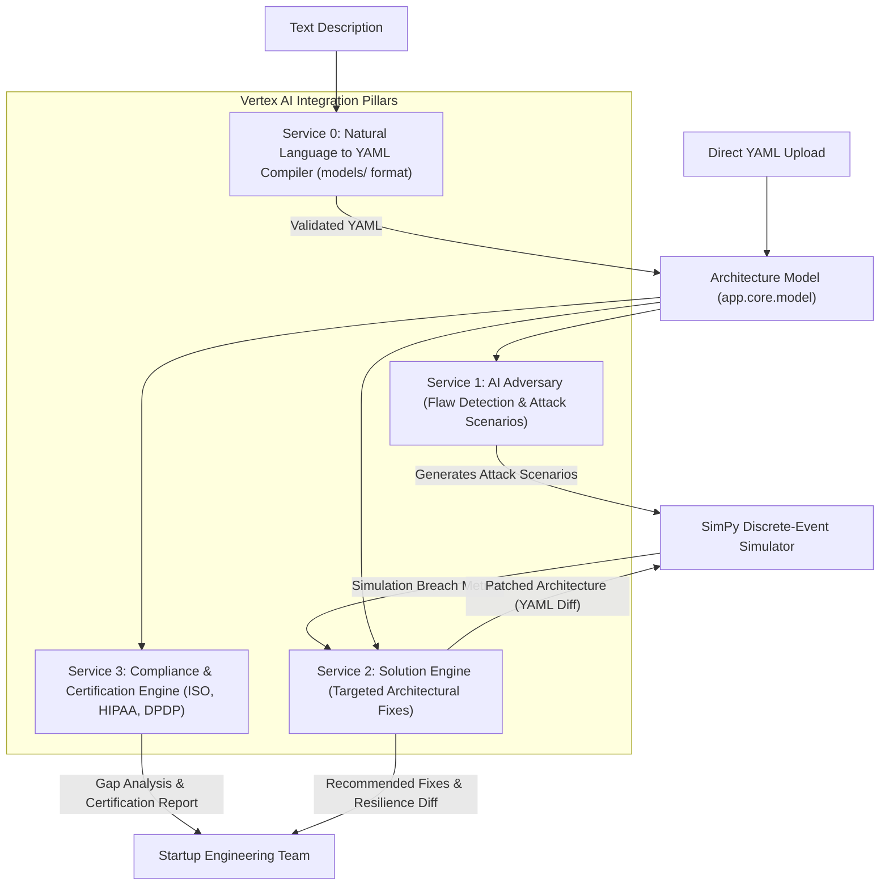

# Venessa: Vertex AI Integration & System Architecture Specification

> **Google Buildathon 2026 Project**  
> *Pre-Mortem Architecture Simulator & Compliance Verifier*  
> **Target GCP Project ID**: `boreal-union-515307-d9`  
> **Primary Region**: `asia-south1` (Mumbai)  
> **Default Model**: `gemini-3.5-flash` via Vertex AI

---

## 1. Executive Summary & Design Philosophy

Venessa uses **Google Cloud Vertex AI (Gemini)** not as a standalone conversational chatbot, but as an **orchestrated reasoning and generative intelligence layer** coupled with a **deterministic simulation and validation core**. 

The fundamental principle of Venessa is:
> **"Vertex AI proposes, deterministic engines verify, and Vertex AI synthesizes."**

LLMs alone are prone to hallucinating performance characteristics, queue dynamics, and latency distributions. Conversely, deterministic discrete-event simulators (like SimPy) cannot creatively devise worst-case failure scenarios, understand messy multi-cloud architectures, or interpret regulatory legal statutes. Venessa combines the two: Vertex AI handles cognitive reasoning, adversarial scenario synthesis, remediation design, compliance auditing, and natural language to YAML compilation; deterministic code handles queueing simulation, mathematical load propagation, and SLO verification.

---

## 2. Where Vertex AI is Leveraged

Vertex AI is strategically deployed across **four core functional areas**:



---

### Service 0: Natural Language Text Description to Architecture YAML Converter

#### Purpose
Startups moving fast need zero-friction onboarding. Founders and engineers describe their system in conversational plain English. Vertex AI converts this description into a fully validated architecture YAML file conforming to the platform's schema and matching the reference standards in `./backend/models/`.

#### Reference Model Formats Followed
The Vertex AI prompt and output parser strictly follow the 3 canonical production reference models in `./backend/models/`:
1. **`ecommerce_checkout.yaml`**: Web/mobile ingress $\rightarrow$ edge load balancer $\rightarrow$ checkout API $\rightarrow$ Redis cart cache, inventory service, payment gateway adapter, Stripe API, and order datastore with retry policies and connection pools.
2. **`ai_inference_pipeline.yaml`**: API client ingress $\rightarrow$ ingress gateway $\rightarrow$ prompt orchestrator $\rightarrow$ vector cache, vector embeddings database, and LLM GPU worker pool.
3. **`saas_analytics_platform.yaml`**: High-throughput ingestion stream $\rightarrow$ stream LB $\rightarrow$ shard router $\rightarrow$ partitioned stream workers $\rightarrow$ primary analytics datastore with read replicas and read/write splitting (`write_ratio`).

#### Validated Architecture Schema
Every generated YAML strictly adheres to `app.core.model.Architecture`:
- `name`: Identifier string
- `slo`: Target Service Level Objectives (`error_rate_max`, `p99_ms_max`, `window_s`, `recover_within_s`)
- `traffic`: Synthetic traffic sources (`sources` with `name`, `target`, `rps`, `timeout_ms`)
- `nodes`: List of services, datastores, caches, load balancers, and external dependencies (`id`, `type`, `replicas`, `concurrency_per_replica`, `queue_per_replica`, `latency_ms: {p50, p99}`, `startup`, `health_check`, `warm_hit_rate`, `read_replicas`)
- `edges`: Directed inter-service calls (`from`, `to`, `timeout_ms`, `retry: {attempts, backoff, base_ms, max_ms, jitter}`, `pool`, `p`, `via_cache`, `write_ratio`)

---

### Service 1: Finding Flaws in the Architecture (The AI Adversary)

#### Purpose
Traditional testing relies on human engineers manually writing test scenarios. However, engineers test only happy paths or obvious failure modes. The **AI Adversary** acts as a red-team reliability architect whose sole objective is to **break the proposed system** before it ever reaches production.

#### How Vertex AI Powers It
1. **Topology & Context Ingestion**:
   - Vertex AI ingests the complete graph specification: services, databases, queues, cache layers, third-party APIs, cross-cloud egress links, timeout budgets, and retry parameters.
2. **Weakness Hypotheses Formulation**:
   - Analyzes structural anti-patterns:
     - Cross-cloud network boundaries subject to latency jitter (e.g., GCP Cloud Run calling an AWS RDS instance).
     - Multi-layer retry amplification without exponential backoff or jitter.
     - Hidden single points of failure (SPOFs) and synchronous downstream dependencies.
     - Services sharing a single un-partitioned transactional datastore.
     - Cold-start restart deadlocks during high-concurrency boot sequences.
3. **Executable Scenario Generation**:
   - Outputs strict, machine-executable **`Scenario` YAML** matching `./backend/scenarios/*.yaml`:
     - Traffic ramps (e.g., spiking ingress from 100 RPS to 3,000 RPS).
     - Timed fault injection events (e.g., *"At t=45s, inject 3,500ms latency on Node `auth-gateway` for 30s"*).
     - Partial cluster or network partitions (e.g., dropping 40% of packets on the cross-region link).
4. **Adversary Verification Loop**:
   - The generated scenario is fed into the deterministic simulation engine (`app.core.engine`).
   - If the scenario breaches SLOs, the attack is flagged as a **Confirmed Outage Vulnerability** and narrated step-by-step.

---

### Service 2: Coming Up with Solutions (Targeted Architectural Fixes)

#### Purpose
Identifying that an architecture will fail is only half the battle. Early-stage startups need actionable, concrete engineering blueprints to fix flaws without delaying product launch.

#### How Vertex AI Powers It
1. **Root-Cause Telemetry Ingestion**:
   - Receives simulation breach metrics: saturated queues, failing node IDs, breached latency percentiles, and cascade propagation paths.
2. **Prescriptive Architecture Design**:
   - Maps root causes to battle-tested Google Cloud and cloud-native resilience patterns:
     - **Retry Storms & Cascade Overload** $\rightarrow$ Insert Google Cloud Pub/Sub queue buffer with dead-letter topics.
     - **Read-Heavy Database Bottlenecks** $\rightarrow$ Introduce Memorystore Redis caching or Cloud SQL read replicas with connection pooling.
     - **Slow Third-Party Dependencies** $\rightarrow$ Apply circuit breakers, aggressive caller timeouts, and fallback degradation strategies.
     - **Multi-Cloud Latency Fluctuations** $\rightarrow$ Implement edge caching, regional colocation, or asynchronous replication.
3. **Automated YAML Patch Generation (Architecture Diffs)**:
   - Outputs modified node definitions, adjusted concurrency parameters, and updated edges.
4. **Closed-Loop Verification**:
   - Applies the patch to the architecture model, re-simulates against the exact same adversarial scenario, and proves resilience with side-by-side metrics.

---

### Service 3: Compliance & Certification Engine

> **Status**: Architecture & Specification Phase (Buildathon Roadmap).

#### Purpose
Startups targeting enterprise clients or regulated verticals must comply with standards like ISO 27001, HIPAA, SOC 2, and DPDP. Discovering non-compliance after provisioning infrastructure results in painful architectural rewrites. This engine evaluates compliance **at design time before any cloud resources are created**.

#### Regulatory Frameworks
- **ISO/IEC 27001**: Operational procedures, network security management, backup redundancy, and security in development.
- **HIPAA**: PHI isolation, end-to-end encryption in transit/at rest, audit controls, and multi-region backup.
- **SOC 2**: Availability, confidentiality, and processing integrity controls.
- **DPDP / GDPR**: Data residency (pinning sensitive stores to India `asia-south1`), and cross-border egress tracking.
- **PCI-DSS**: Cardholder data environment (CDE) isolation and network segmentation.

---

## 3. End-to-End System Architecture with Vertex AI

```mermaid
graph TB
    subgraph Client Layer
        WebUI["React + TypeScript + Vite UI<br/>(React Flow Graph Canvas)"]
        NLInput["Natural Language Input Bar"]
        YAMLInput["Direct YAML Editor / Upload"]
        ReportView["Pre-Mortem & Compliance Dashboard"]
    end

    subgraph Google Cloud Run / Backend Gateway
        API["FastAPI Application Server<br/>(uvicorn / asia-south1)"]
        
        subgraph API Endpoints
            EP_Ingest["/api/ai/text-to-model"]
            EP_Adversary["/api/ai/adversary"]
            EP_Remediate["/api/ai/remediate"]
            EP_Compliance["/api/ai/compliance"]
            EP_Simulate["/api/simulate"]
            EP_Analyze["/api/analyze"]
        end
    end

    subgraph Core Engine Layer (Deterministic)
        ModelValidator["Pydantic Architecture & Scenario Validator"]
        StaticAnalyzer["Static Graph Analyzer<br/>(SPOF, Retry Amplification, Timeouts)"]
        SimPyEngine["Discrete-Event Simulation Core<br/>(Queues, Latency Distributions, Replicas)"]
        MetricsCollector["Time-Series Telemetry & Breach Collector"]
    end

    subgraph Google Cloud Vertex AI Layer (boreal-union-515307-d9)
        VertexClient["Vertex AI Client SDK<br/>(google-genai / asia-south1)"]
        GeminiFlash["gemini-3.5-flash<br/>(Fast NL Parsing, Adversary & Fixes)"]
        
        subgraph Vertex Workflows
            W_Parser["Natural Language to YAML Compiler (models/ schema)"]
            W_Adversary["Adversarial Attack Scenario Generator"]
            W_Fix["Targeted Fix & YAML Patch Generator"]
            W_Compliance["Multi-Standard Compliance Auditor"]
        end
    end

    %% Wiring
    NLInput --> EP_Ingest
    YAMLInput --> API
    WebUI --> API
    
    API --> EP_Ingest & EP_Adversary & EP_Remediate & EP_Compliance & EP_Simulate & EP_Analyze
    
    EP_Ingest --> W_Parser
    EP_Adversary --> W_Adversary
    EP_Remediate --> W_Fix
    EP_Compliance --> W_Compliance
    
    W_Parser & W_Adversary & W_Fix & W_Compliance --> VertexClient --> GeminiFlash
    
    EP_Simulate --> ModelValidator --> SimPyEngine --> MetricsCollector
    EP_Analyze --> StaticAnalyzer
    
    W_Parser -->|"Validated Architecture YAML"| ModelValidator
    W_Adversary -->|"Synthesizes Scenario YAML"| ModelValidator
    MetricsCollector -->|"Breach Telemetry"| W_Fix
    
    W_Fix -->|"Outputs Patched Architecture"| WebUI
    W_Compliance -->|"Outputs Certification Scorecard"| ReportView
```

---

## 4. Configuration & Vertex AI Environment

The backend connects directly to Google Cloud Vertex AI using:
- **Project ID**: `boreal-union-515307-d9`
- **Location**: `asia-south1`
- **Model**: `gemini-3.5-flash`
- **SDK**: `google-genai` with `vertexai=True`
- **Auth**: Application Default Credentials (`gcloud auth application-default login`)

---

## 5. Development Roadmap & Status

| Feature / Module | Vertex AI Role | Implementation Status |
|---|---|---|
| **Deterministic Simulation Engine** | Pure SimPy discrete-event core | **Implemented & Tested** (`app/core/engine.py`, 23 passing tests) |
| **Static Architecture Analyzer** | Graph theoretical checks | **Implemented** (`app/core/analyze.py`) |
| **Reference Architecture Models** | E-commerce, AI Inference, SaaS Analytics | **Available in `./backend/models/`** |
| **Service 0: Text-to-YAML Compiler** | Gemini 3.5 Flash converts text $\rightarrow$ `./backend/models` YAML | **Implementing Now** (`app/ai/parser.py`) |
| **Service 1: AI Adversary (Flaws)** | Gemini 3.5 Flash generates failure scenarios | **Implementing Now** (`app/ai/adversary.py`) |
| **Service 2: Solution Engine (Fixes)** | Gemini 3.5 Flash produces YAML patches & diffs | **Implementing Now** (`app/ai/remediator.py`) |
| **Service 3: Compliance & Certification** | Gemini 3.5 Flash audits ISO, HIPAA, DPDP | **Specified & Designed** (`app/ai/compliance.py`) |
